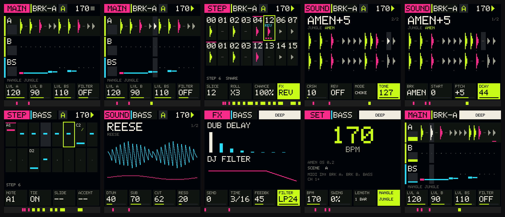
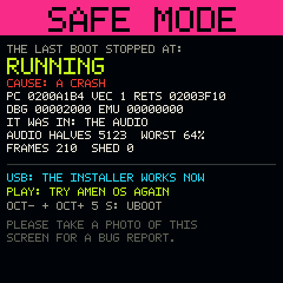
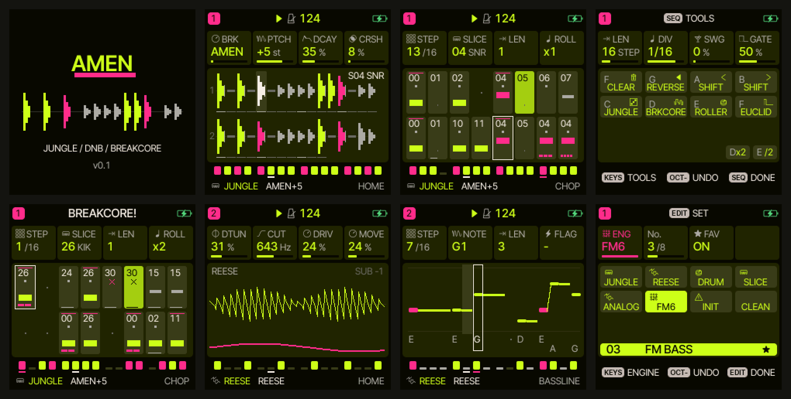

# AMEN-FM1

**AMEN OS** — своя прошивка для **M-VAVE FM-1** под **jungle, drum & bass и breakcore**. Свои звук, секвенсор, экраны, шрифт и управление.

> **AMEN OS 0.3 — тестовая сборка.** Версия 0.2 на первом же FM-1 не запустилась: чёрный экран, затем режим UBOOT.
> Сайт https://joolo09.github.io/amen-fm1/ по умолчанию ставит прежнюю прошивку — AMEN на проверенном ядре Felucca
> (раздел «Предыдущий вариант» ниже). AMEN OS 0.3 ставится только по отдельной ссылке
> https://joolo09.github.io/amen-fm1/?fw=os. Что в ней изменилось — раздел «Запуск и SAFE MODE» ниже.
>
> **Если FM-1 не запускается — [инструкция по восстановлению](docs/RESCUE.md).**



Экраны выше — снимки из симулятора AMEN OS: тот же код, что в прошивке, на ПК (`make sim`). Полосы внизу — светодиоды кнопок и клавиш.

- **Три дорожки:** BRK-A и BRK-B — два нарезанных брейка (8 брейков × 32 слайса, синтезируются, сэмплов нет), BASS — reese-бас со слайдами и акцентным фильтром. Других звуков нет.
- **8 сцен** A–H, по 16 или 32 шага, переключение с конца такта. В прошивке уже есть демо-сцены: JUNGLE, ROLLER, HALFTIME, BRKCORE.
- **Шаг брейка:** слайс, ролл x1–x4, вероятность, эффект шага: REV (слайс задом наперёд), UP/DN (питч ±12), CUT (обрыв на полшага).
- **Шаг баса:** нота, связка, слайд, акцент.
- **Перформанс:** MANGLE (новый эдит в стиле JUNGLE / ROLLER / HALFTIME / BRKCORE), бит-репит 1/4…1/32, tape stop, мьюты, даб-дилей, DJ-фильтр, запись с клавиш, MIDI-вход.

Управление, экраны и устройство — [docs/AMEN-OS.md](docs/AMEN-OS.md). Коротко:

| Кнопка | Что делает |
|---|---|
| PLAY / REC | старт-стоп / запись с клавиш |
| HOME / SEQ / EDIT / FX / GLO | экраны MAIN / STEP / SOUND / FX / SET |
| ENV | MANGLE: новый эдит дорожки |
| ARP (держать) | бит-репит, белые клавиши 1–4 выбирают 1/4…1/32 |
| LFO (держать) | tape stop |
| SCL | мьют дорожки |
| SAVE | сохранить проект |
| OCT− / OCT+ | такт шагов, страница звука, окно слайсов, октава баса |
| OCT− + OCT+ 5 с | режим обновления (можно поставить любую другую прошивку) |
| SELECT / ALGORITHM / PRESETS | дорожка / сцена / звук |
| K1–K4 | параметры экрана, подписаны внизу |

> **Статус: экспериментальная, на железе не запустилась (см. выше).** Логика и экраны проверены в симуляторе: сценарий проверок и снимки экранов в CI. Прошивка собирается тулчейном JieLi в GitHub Actions; пакет `amen-os-0.2.fwsc`, идентификатор `FM-1_702`. Путь обновления по USB-MIDI в прошивке есть. Ещё есть защита от зацикленной загрузки: после двух неудачных стартов подряд FM-1 сам уходит в режим обновления. Первую прошивку ставьте с запасом времени. Перед этим сохраните проекты заводской прошивки программой M-VAVE.

Послушать: [docs/demo.mp3](docs/demo.mp3) — звук из сессии симулятора: сцены, MANGLE, бит-репит, tape stop.

## Запуск и SAFE MODE (0.3)

После версии 0.2 загрузка переделана так, чтобы сбой больше не уводил FM-1 в «кирпич»:

- Экран включается первым, внизу во время загрузки зажигаются клетки этапов.
- Если загрузка или работа сорвалась (падение, зависание, сторожевой таймер), следующий запуск — **SAFE MODE**: розовый экран, на нём этап, на котором всё остановилось, причина (crash или watchdog), регистры падения, где был код (звук, экран, цикл), сколько успело проработать и худшая загрузка звука. Звука и приложения в SAFE MODE нет, а USB и установщик работают: можно прошить заново или вернуть AMEN 0.1.
- **HOME** при включении — тоже SAFE MODE. **PLAY** в SAFE MODE — ещё одна попытка запустить AMEN OS.
- Только если не запустится и SAFE MODE (три неудачи подряд), FM-1 уходит в UBOOT, как раньше.
- Запуск повторяет порядок Felucca (звук до таймеров, USB не опрашивается внутри звукового прерывания), буферы DMA выровнены, сборка линкуется как у Felucca, без `--gc-sections`.
- Если звук не успевает (больше 85% времени блока), гасится самый старый голос; если не успевает долго — пауза ~1,7 с вместо зависания.



## Из чего сделана AMEN OS

- `os/` — вся прошивка: ядро (голоса, секвенсор, микшер, эффекты), интерфейс (свой шрифт, экраны, управление), симулятор для ПК (`os/host/sim.c`), платформа FM-1 (`os/fm1/main.c`).
- `engines/` — движки JUNGLE и REESE.
- От Felucca взят только скрытый слой железа: [felucca-bsp](https://github.com/hugelton/felucca-bsp) (MPL-2.0, в `fw/firmware/bsp`). Это драйверы экрана, клавиш, энкодеров, светодиодов, аудиокодека, USB, флеша, путь обновления и загрузчик. Интерфейса, секвенсора и звука Felucca в AMEN OS нет.

## Предыдущий вариант: AMEN на Felucca

До AMEN OS прошивка была Felucca со встроенными JUNGLE и REESE и переделанным интерфейсом (`fw/`, [fw/AMEN.md](fw/AMEN.md)). Её исходники остаются в репозитории.

### Интерфейс



Экраны выше — рендер настоящего кода отрисовки прошивки. Слева направо, сверху вниз:
- **Заставка.**
- **BREAK MAP** (дом трека JUNGLE): весь брейк — 32 слайса, два такта. Каждый слайс нарисован как транзиент: бочка — кислотная, снейр — розовый, хэты, райд и призрачные — серые. Звучащий слайс подсвечен и подписан (S04 SNR). Линия под слайсами — окно 27 клавиш (сдвигается ручкой START).
- **CHOP** (секвенсор трека JUNGLE): шаг — это слайс с мини-картинкой его ударов. Ручки:
  - **K1** — шаг;
  - **K2 SLICE** — слайс по кругу из 32, с подписью KIK / SNR / GHO / HAT / RDE;
  - **K3** — длина;
  - **K4 ROLL** — ролл x1…x4, видно полосками.

  Вероятность шага (DETAIL) — полоса снизу, акцент — линия сверху.
- **SEQ TOOLS** (держать SEQ) на JUNGLE — генераторы эдитов вместо RANDOM / COOK / BEAT:
  - **JUNGLE** — брейк с классическими перестановками: повтор полутакта, перебивки снейром, ролл в следующий такт;
  - **BRKCORE** — злая нарезка: роллы x3/x4, паузы, вероятности, повторы;
  - **ROLLER** — DnB two-step из бочек, снейров и призраков этого брейка.

  Каждое нажатие даёт новый вариант; SAVE (удержание) — отмена.
- **REESE**: биения двух осцилляторов (DTUN), форма (REESE / HOOVER / NEURO / SQUARE), фильтр и саб.
- **BASSLINE** (секвенсор трека REESE): ноты — полосы на своей высоте, связки тянутся, слайды рисуются глиссандо, акценты розовые, имена нот внизу.
- **Выбор движка**: только нужное — JUNGLE, REESE, DRUM, SLICE (свои WAV-брейки), ANALOG (хуверы, стабы), FM6 (пэды для liquid).

Тема AMEN: почти чёрный фон, кислотный жёлто-зелёный, розовый акцент. Остальные палитры Felucca доступны в меню.

### Из чего был сделан вариант на Felucca

Писать прошивку FM-1 с нуля, без устройства на руках, означало бы вслепую писать драйверы экрана, клавиш, звука, USB и флеша. Поэтому AMEN построена так же, как SLOOP: на открытом ядре **[Felucca](https://github.com/hugelton/Felucca) 1.9.0** (GPL-3.0). Его «железный» слой, секвенсор, UI и загрузчик обновлений работают на FM-1 и проверены сообществом.

AMEN меняет в нём вот что:
- встраивает свои движки JUNGLE и REESE (номера 2 и 6, вместо PHASE и TRIO);
- задаёт стартовые треки, фразы и темп;
- показывает своё имя на заставке и в меню.

Полный список изменений — [fw/AMEN.md](fw/AMEN.md). Исходники ядра лежат в `fw/`, сборка — `tools/build_amen.sh`.

Заводская прошивка M-VAVE и официальная «FM1 Open» не подходят как основа: звуковой движок и секвенсор у них в закрытой библиотеке.

## Движки как плагины для обычной Felucca

Если вы остаётесь на Felucca 1.9+, JUNGLE и REESE можно поставить в неё плагинами. Плагины ставятся без пересборки прошивки и переживают её обновления.

Вручную:

1. Поставить на FM-1 **Felucca 1.9+** (сборка с плагинами; на момент написания 1.9 в бете) через [веб-установщик](https://hugelton.github.io/Felucca/) в Chrome/Edge. Вернуться на заводскую прошивку можно через тот же установщик (Return to official V15) или M-UPGRADE от M-VAVE.
2. Скачать готовые плагины: вкладка **Actions** репозитория → последний успешный запуск **build** → артефакт **amen-fm1-fep** (zip с `jungle.s0.fep` и `reese.s1.fep`). Или собрать самому: `make fm1` (нужен тулчейн JieLi, [docs/BUILD.md](docs/BUILD.md)).
3. Залить их утилитой Felucca (`pip3 install mido python-rtmidi`):

   ```bash
   python3 tools/fm1_plugin.py install jungle.s0.fep
   ```

   ```bash
   python3 tools/fm1_plugin.py install reese.s1.fep
   ```

   (`tools/fm1_plugin.py` лежит в репозитории Felucca.) FM-1 перезагрузится, и JUNGLE с REESE появятся на ручке ENG после движков Felucca.

Если FM-1 упадёт внутри плагина, Felucca при следующем включении запустится без плагинов. Тогда очистите слот (`fm1_plugin.py erase 0`) и пришлите отчёт.

## Быстрый старт: первый брейк за минуту

1. Прошивка AMEN стартует на **170 BPM** (jungle/DnB; для breakcore поднимите до 180–200+), трек 1 — JUNGLE. На Felucca с плагинами: трек 1 → ENG **JUNGLE**, пресет **AMEN**.
2. Нажмите PLAY: играет jungle-эдит. Остановите и поиграйте клавишами.
3. Нижняя клавиша (F3) — слайс 0, следующая клавиша — слайс 1 и так далее, хроматически, без лада. Сыграйте клавиши подряд снизу вверх по шестнадцатым — получится брейк как есть.
4. Запишите в секвенсор другие слайсы на шаги, и брейк перестроится. Это и есть «edit» брейка.
   По MIDI: нота 60 (C4) — слайс 0, 61 — слайс 1… по кругу из 32 (плюс START).
5. Трек 2 → ENG **REESE**, пресет **REESE** или **DEEP**: длинные ноты в E/F минор, 1–2 ноты на такт.

## JUNGLE: параметры

| Страница | Ручка | Что делает |
|---|---|---|
| BREAK | **BRK** | Какой брейк: AMEN, THINK, FUNKY, APACHE, ROLLER, HALF, ROLLS, RAGGA |
| BREAK | **START** | Сдвиг карты слайсов: нижняя клавиша = слайс START (0–31). Так достаются слайсы 27–31 и второй такт |
| BREAK | **PTCH** | ±12 полутонов, как варипитч сэмплера: брейк ускоряется и звучит выше, удары короче. +3…+7 — классический jungle |
| BREAK | **DCAY** | Длина ударов, 0,25×…2,2× |
| CHOP | **CRSH** | Драйв → понижение частоты дискретизации (до ~5,5 кГц) → понижение разрядности. 40–80 — SP-1200/Akai, 100+ — разваленный цифровой брейккор |
| CHOP | **REV** | OFF / ON / R25% / R50%: реверс слайса (шестнадцатая играется от конца к удару), постоянно или случайно на 25/50 % нот |
| CHOP | **MODE** | **CHOKE** (по умолчанию): новый слайс глушит предыдущий за 2 мс, как один голос сэмплера. **GATE**: ещё и обрыв по note-off (длину задаёт гейт шага, получаются стабы). **POLY**: слайсы звенят друг поверх друга |
| CHOP | **TONE** | Низкочастотный фильтр поверх слайса (127 = открыт) |

На HOME четыре ручки: BRK, PTCH, DCAY, CRSH.

**Хвосты.** Слайс содержит то, что ещё звучит от предыдущих шестнадцатых, как вырезка из записи. Пустая шестнадцатая играет хвост бочки или райда перед ней, а не тишину. Хэт после бочки звучит поверх её гула.

**Пресеты:** AMEN, AMEN+5, SP1200, THINK, FUNKY, APACHE, ROLLER, HALFTME, RAGGA, REVERSE, BRKCORE, GABBER, STABS, WASH.

## REESE: параметры

| Ручка | Что делает |
|---|---|
| **DTUN** | Расстройка двух осцилляторов, до ±50 центов: скорость биений |
| **SUB** / **SUBO** | Громкость синусного саба и его октава (−1 / −2) |
| **CUT** / **RESO** | Резонансный ФНЧ (плюс огибающая и модуляция фильтра трека Felucca) |
| **DRIV** | Драйв в софт-клип до фильтра: рык |
| **MOVE** | Медленный LFO (0…~3 Гц) на расстройку и срез: бас «дышит» и фазирует |
| **WAVE** | REESE (две пилы), HOOVER (пульс с ШИМ + пилы), NEURO (разность пил через клип: гнусавый нейрофанк), SQUARE (два меандра: глухо) |

**Пресеты:** REESE, DEEP, ROLLER, NEURO, TECHSTP, HOOVER, WOBBLE, SUB, JUNGLE.

## Карты брейков

Каждая строка — дорожка инструмента, символ — шестнадцатая (`x` удар). Номер колонки = номер слайса = клавиша от F3 (при START 0).

**0 · AMEN**

```
слайс     0123456789012345 | 6789012345678901
Бочка     x.x.......xx.... | x.x.......x.....
Снейр     ....x.......x... | ....x.......x...
Призрак   .......x.x.....x | .......x.x..x..x
Райд      x.x.x.x.x.x.x.x. | x.x.x.x.x.x.x...
Крэш      ................ | ..............x.
```

**1 · THINK**

```
слайс     0123456789012345 | 6789012345678901
Бочка     x.....x...x..... | x.....x..x......
Снейр     ....x.......x... | ....x.......x...
Призрак   ...x.....x....x. | ...x.....x...x.x
Хэт       xxxxxxxxxxxxxx.x | xxxxxxxxxxxxxx..
Откр.хэт  ..............x. | ..............x.
```

**2 · FUNKY**

```
слайс     0123456789012345 | 6789012345678901
Бочка     x.x...x...x..x.. | x.x...x...x..x..
Снейр     ....x.......x... | ....x.......x...
Призрак   .......x.x.....x | .......x.x..x...
Хэт       xxxxxx.xxxxxxxxx | xxxxxx.xxxxxxxx.
Откр.хэт  ......x......... | ......x.......x.
```

**3 · APACHE**

```
слайс     0123456789012345 | 6789012345678901
Бочка     x..x....x.x..... | x..x....x.x...x.
Снейр     ....x.......x... | ....x.......x...
Призрак   ......x.......x. | ......x....x..x.
Хэт       x.x.x.x.x.x.x.x. | x.x.x.x.x.x.x...
Откр.хэт  ................ | ..............x.
```

**4 · ROLLER**

```
слайс     0123456789012345 | 6789012345678901
Бочка     x.........x..... | x.........x.....
Снейр     ....x.......x... | ....x.......x...
Призрак   .......x.......x | .......x..x....x
Хэт       ..x...x...x...x. | ..x...x...x...x.
Райд      x.x.x.x.x.x.x.x. | x.x.x.x.x.x.x.x.
```

**5 · HALF**

```
слайс     0123456789012345 | 6789012345678901
Бочка     x.....x...x..... | x.....x....x....
Снейр     ........x....... | ........x.......
Призрак   ...........x...x | ...........x.x.x
Хэт       x.x.x.x.x.x.x.x. | x.x.x.x.x.x.x.x.
Откр.хэт  ......x......... | ......x.........
```

**6 · ROLLS**

```
слайс     0123456789012345 | 6789012345678901
Бочка     x.x.x.x.x...x... | xxxx....x.x.x.x.
Снейр     ....x...xxxxxxxx | ....xxxx....xxxx
Призрак   ..x...x......... | ................
Хэт       xxxxxxxxxxxxxxxx | xxxxxxxxxxxxxxxx
Крэш      x............... | ................
```

**7 · RAGGA**

```
слайс     0123456789012345 | 6789012345678901
Бочка     x......x..x..... | x......x..x.....
Снейр     ....x.......x... | ....x.......x.x.
Призрак   ..x..x....x..x.. | ..x..x....x..x..
Хэт       x.x.x.x.x.x.x.x. | x.x.x.x.x.x.x.x.
Откр.хэт  ...............x | ................
```

## Рецепты

Записывайте в шаги секвенсора номера слайсов (клавиша = слайс). Ниже по 16 шагов (один такт), `-` — пауза.

**Jungle edit (AMEN, 165–175 BPM, PTCH +3…+5):**

```
шаг:    1  2  3  4  5  6  7  8  9 10 11 12 13 14 15 16
такт A: 0  1  2  3  4  5  6  7  0  1 10 11 12 13 14 15
такт B: 0  1  2  3  4  5  6  7 10 11  4  5  4  5 12 13
```

Повтор `4 5 4 5` — классическая перебивка снейром. На последний шаг такта B поставьте **RATCH x3/x4** — получится ролл в следующий такт.

**DnB roller (ROLLER или AMEN, 172–174 BPM):** бочка на 1 и «3-и», снейр на 2 и 4, призраки между ними:

```
шаг: 1  2  3  4  5  6  7  8  9 10 11 12 13 14 15 16
     0  1  6  7  4  5  6  7 10 11  2  3 12 13 14 15
```

Под ним REESE / ROLLER в одну ноту на такт, MODE CHOKE.

**Halftime (HALF, 170 BPM):** брейк как есть, снейр на 3-й доле. Под ним **DEEP** или **NEURO**.

**Breakcore (ROLLS/AMEN, 180–220 BPM, пресет BRKCORE):**
- MODE **GATE** и короткие гейты: стабы и «заикания»;
- REV **R25%/R50%**: случайный реверс;
- 32-е роллы: RATCH x2–x4 на снейровых слайсах (4, 12, 20, 28 в AMEN);
- вероятность шагов 50–80 % и разные длины треков (полиметрия) — брейк каждый раз ломается по-разному;
- FX-слой Felucca: REPEAT 1/32 и TAPE STOP на живом исполнении;
- CRSH 90–120 и PTCH ±7 на втором треке JUNGLE поверх первого (пресет GABBER).

**Рэгга-jungle:** RAGGA, PTCH +3, под ним REESE/JUNGLE (саб в меандре), дилей на снейре.

## Свой настоящий брейк (Amen и др.)

JUNGLE синтезирует брейк. Если нужен звук настоящей записи, у Felucca есть свой движок **SLICE** с загрузкой WAV в пользовательский слот:

```bash
python3 tools/fm1_sample_upload.py load 1 AMEN amen.wav
```

(утилита из репозитория Felucca; слот вмещает ~7 с при 22 кГц). Дальше трек → ENG SLICE, SRC USR1, DIV 16 (или AUTO), PTCH для ускорения, REV, MODE ONE. Приёмы из рецептов выше работают так же. Учтите авторские права на записи, если выпускаете музыку.

## Сборка и тесты на ПК

```bash
make test
```

```bash
make demo
```

`make test` проверяет все пресеты и каждое значение каждого параметра (переполнения, зависшие голоса, детерминизм), чок, гейт, реверс, все слайсы всех брейков, хвосты и питч. `make demo` рендерит `build/demo.wav`: 8 тактов при 170 BPM — брейк как есть, jungle edit, DnB-перестановка с роллами, breakcore поверх, и REESE под ними. `make breaks` пишет каждый брейк отдельно (`build/break0.wav`…`break7.wav`). `make plugins` собирает плагины для десктопной Felucca (SDL2, `--plugins build/plugins`).

Подробности, сборка для FM-1 и путь к собственной прошивке: [docs/BUILD.md](docs/BUILD.md).

## Структура

```
fw/                     прошивка AMEN: ядро Felucca 1.9.0 + изменения (fw/AMEN.md)
tools/build_amen.sh     сборка прошивки (amen-X.Y.fwsc)
site/                   сайт-установщик (GitHub Pages), tests/site/ — его тест на эмуляции FM-1
engines/eng_jungle.c    движок JUNGLE (Felucca engine_t)
engines/eng_reese.c     движок REESE
engines/jungle_data.h   брейки и таблицы (генерируется tools/gen_breaks.py)
plugins/*.c             обёртки плагинов (FE_PLUGIN)
host/amen_host.c        десктопный хост: тесты и демо
tools/gen_breaks.py     брейки: правьте паттерны здесь
tools/gen_tables.py     таблицы хоста (как у Felucca)
tools/build_fm1.sh      сборка .fep для FM-1
sdk/                    интерфейс плагинов Felucca-Engines (MIT, без изменений)
```

Свой брейк добавляется в `tools/gen_breaks.py` (дорожки `x`/`.`), затем `make` пересоберёт данные. Брейков может быть до 32 при наличии места в слоте.

## Лицензии

Движки, хост и инструменты AMEN-FM1 — GPL-3.0-only ([LICENSE](LICENSE)). Прошивка AMEN (`fw/`) — Felucca 1.9.0 © Leo Kuroshita / Hügelton Instruments и сообщество, GPL-3.0-only, с лицензиями её частей в [fw/LICENSING.md](fw/LICENSING.md) и [fw/LICENSES/](fw/LICENSES/); пакет прошивки содержит три файла JieLi AC79 SDK (Apache-2.0). `sdk/` — интерфейс плагинов и `dsp.c` из [Felucca-Engines](https://github.com/hugelton/Felucca-Engines) © Leo Kuroshita / Hügelton Instruments, MIT ([sdk/LICENSE](sdk/LICENSE)). Брейки — оригинальные аранжировки в стиле классических фанк-брейков; записи не используются. M-VAVE и FM-1 — товарные знаки их владельцев; проект с ними не связан.
